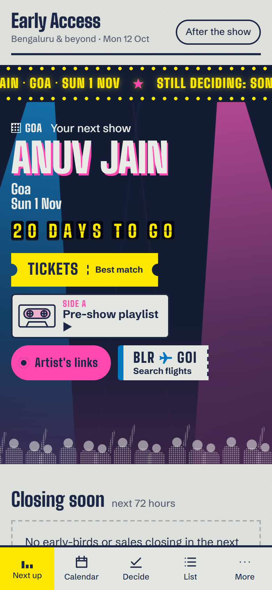
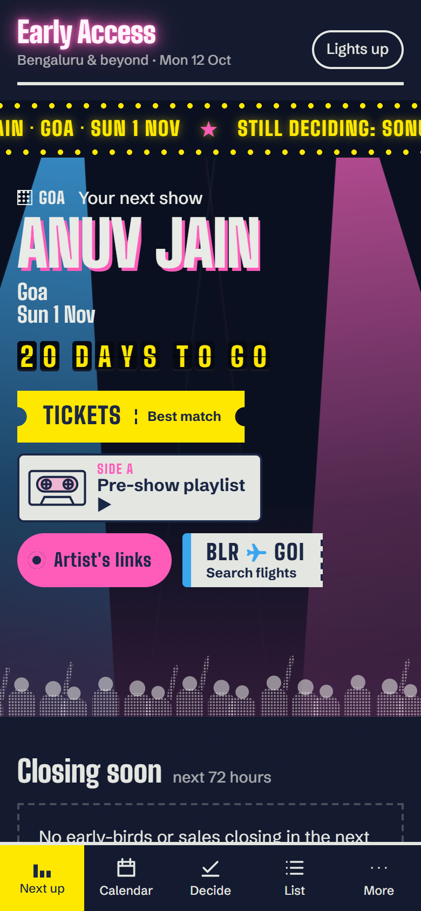
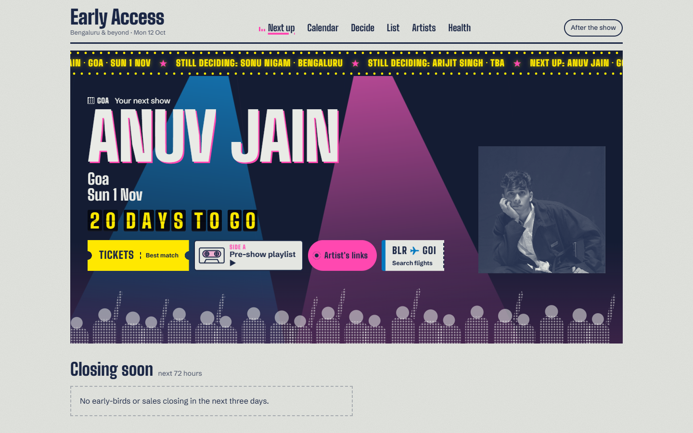

# Design plan: the gig wall

Live Show Radar's dashboard is for one person whose favourite thing is live music. It should feel like the wall by the door of a small Bengaluru venue: risograph flyers, ticket stubs, a wristband or two. It shouldn't look like an admin panel.

The test for every screen: **would this look the same for any other dashboard?** If yes, it isn't done.

## 1. Concept

Every show is a printed object, mainly a **ticket stub**. Everything else is quiet paper, navy ink and condensed poster type. All the boldness goes into the stub and its one orchestrated moment: the **ADMITTED stamp**.

## 2. Colour tokens

Risograph inks on cool concrete-grey paper. Inks are for fills, marks, stamps and highlights. Body text is always navy on paper.

| Token | Light ("in the venue") | Dark ("after the show") | Use |
|---|---|---|---|
| `--paper` | `#E4E6E1` | `#141B30` | page background |
| `--paper-2` | `#D6D9D2` | `#1B2440` | stub body, inset surfaces (a second sheet, not a card) |
| `--ink` | `#1B2745` | `#E4E6E1` | text, rules, outlines |
| `--ink-soft` | `#1B2745B3` (70%) | `#E4E6E1B3` | secondary text (≥ 4.5:1 on paper in both themes) |
| `--blue` | `#0078BF` | `#3AA6EE` | Bengaluru ink |
| `--pink` | `#FF48B0` | `#FF5CBA` | urgency: tier A, early-bird closing, the ADMITTED stamp |
| `--yellow` | `#FFE800` | `#FFE800` | highlighter under decide-by deadlines |
| `--halftone` | navy dots at 18% | paper dots at 22% | out-of-city ink (pattern, not just colour) |

Rules:
- **Overprint.** Where pink sits over blue (an urgent Bengaluru stub), the top ink uses `mix-blend-mode: multiply` in light mode (`screen` in dark), so the overlap turns purple like a real two-pass riso print.
- **Never colour alone.** Bengaluru vs elsewhere always comes with a city label ("BLR", "PUNE"). Bengaluru gets a solid blue ink bar; other cities get a navy halftone bar. Urgency always comes with words ("closes in 31 hrs").
- **Contrast (computed).** Navy on paper 11.7:1, on the stub sheet 10.3:1, on yellow 11.8:1, on pink 4.8:1 (stamp text passes AA). Soft ink is 5.0:1 on paper and 4.7:1 on the stub sheet. In dark mode, paper-ink on navy is 13.6:1 and soft ink 7.2:1. Blue on paper is only 3.8:1, so text never sits in blue: blue is only a bar or mark next to navy text.
- **No** gradients, soft shadows, cream, terracotta, or single-neon-on-black. The only "shadow" is a 2px hard navy offset on the poster hero, a misregistered second pass.
- **Paper grain.** An SVG `feTurbulence` noise layer at 6% opacity (4% in dark mode), fixed to the page.

## 3. Type

- **Display: Big Shoulders Display** (Google Fonts, variable 400–900) for artist names, dates, the calendar and section titles. It's a condensed, Chicago gig-poster grotesque.
- **Body/UI: Schibsted Grotesk** (400/500/700) with `font-variant-numeric: tabular-nums` everywhere numbers change, so countdowns don't jitter.
- No Inter, no monospace for data, and no all-caps eyebrow labels. Capitals appear only where a poster would print them: the hero artist name, the stamp, and the city codes on stubs.

| Role | Font | Size (mobile → desktop) | Weight / leading |
|---|---|---|---|
| Poster artist (hero) | Big Shoulders | `clamp(3.5rem, 15vw, 8.5rem)` | 900 / 0.84, uppercase |
| Poster meta (venue, date) | Big Shoulders | `clamp(1.25rem, 4.5vw, 2rem)` | 700 / 1 |
| Section title | Big Shoulders | `1.75rem → 2.25rem` | 800 / 1, sentence case |
| Stub artist | Big Shoulders | `1.9rem → 2.4rem` | 800 / 0.9 |
| Stub date | Big Shoulders | `1.1rem` | 700, uppercase day ("SAT 13 DEC") |
| Countdown (stub tear-off) | Big Shoulders | `1.6rem` | 800 / 0.95, tabular |
| Body | Schibsted Grotesk | `1rem` | 400 / 1.45 |
| Small / meta | Schibsted Grotesk | `0.875rem` | 500 / 1.35 |

## 4. Layout

- Mobile first, 320 px minimum, 16 px side gutter, no horizontal page scroll (the "Closing soon" strip scrolls inside itself with scroll-snap).
- **Mobile:** a bottom bar with Next up · Calendar · Decide · List · More (Artists, Health). Labels always show next to icons drawn as simple line glyphs.
- **Desktop (≥ 900 px):** a masthead like a flyer header ("Live Show Radar", with the month and "Bengaluru & beyond" set beside it), nav links in the masthead, and content in a 12-column grid with a max width of 1180 px.
- Radii are deliberately mixed: stubs have notches, not rounded corners; buttons are 2px; the stamp is square; city chips are pills.

## 5. Wireframes

### Home ("Next up"), mobile

```
┌──────────────────────────────────┐
│ Live Show Radar          ◐  ☰   │  masthead: wordmark left, theme toggle
├──────────────────────────────────┤
│ ███ BLR                          │  blue ink bar + city code
│ PRATEEK                          │  poster artist, 900 weight, tight
│ KUHAD▒                           │  ▒ = 2px misregistered navy offset
│ Phoenix Marketcity Arena         │
│ Sat 12 Dec · 62 days to go       │
│ ♫ Pre-show playlist              │  link, underlined in pink
├──────────────────────────────────┤
│ Closing soon                     │  section title (sentence case)
│ ┌───────────┬┄┄┐┌───────────┬┄┄┐ │  horizontal snap strip of mini stubs
│ │SAT 13 DEC ┆EB│ │FRI 20 NOV ┆ON│ │
│ │LIFAFA     ┆31│ │THE LOCAL  ┆SA│ │
│ │■ BLR      ┆h │ │▒ PUNE     ┆LE│ │
│ └───────────┴┄┄┘└───────────┴┄┄┘ │
├──────────────────────────────────┤
│ Decide by                        │
│ [stub] [stub] …                  │  maybe shows, earliest deadline first;
│                                  │  deadline highlighted in yellow
├──────────────────────────────────┤
│ Just announced                   │
│ [stub] [stub] …                  │  newest first
├──────────────────────────────────┤
│ Next up  Calendar  Decide  List  More │  bottom bar
└──────────────────────────────────┘
```

### The stub

```
 ┌─────────────────────────────────────┬ ─ ─ ─ ─ ─ ┐
 ▌SAT 13 DEC                           ┆ EARLY-BIRD │
 ▌LIFAFA                               ┆ closes in  │
 ▌Fandom at Gilly's                    ┆ 31 hrs     │  ← tear-off: live countdown
 ▌BLR · tier B · ₹799 early bird       ┆ Fri 11:59PM│
 ▌[Going] [Maybe] [Pass] [Open tickets]┆            │
 └─────────────────────────────────────┴ ─ ─ ─ ─ ─ ┘
 ▌ = 8px ink bar (blue = Bengaluru, halftone = elsewhere; pink overprints for urgent)
 ┆ = perforation: dotted rule plus two semicircle notches cut from the top and bottom edges
```

- **Torn:** when the deadline passes or every tier sells out, the tear-off is gone. The stub's right edge becomes a ragged zigzag (`clip-path`), with "Sold out" or "Early-bird over" set small in the margin.
- **Admitted:** once Going, a square ADMITTED stamp in pink sits rotated −8° across the stub's right half, multiply-blended, with a faint double edge like an inked rubber stamp.

### Calendar (flyer gig listing)

```
 DECEMBER 2026                         ◀ ▶     ← month in 900 condensed, huge
 ─────────────────────────────────────────────
 Mobile: a listing, one row per show day
 FRI 04  NH7 WEEKENDER · PUNE ▒               tier A pink mark if urgent
 SAT 05  LIFAFA · BLR ███
 SAT 12  PRATEEK KUHAD · BLR ███   ADMITTED
 SUN 13  WHEN CHAI MET TOAST · MUM ▒

 Desktop: 7-column grid, Mon–Sun, day numbers in display type,
 artist names condensed inside the day, ink bar + city code per show.
 Empty days are plain paper; today has a navy hairline box.
```

### List, Decide-by, Artists, Health

- **List:** filter row of chips (city, tier, status, date range), then stubs.
- **Decide-by:** stubs sorted by deadline, with the deadline line on a yellow highlighter, the current price tier, Going / Pass, and for shows outside Bengaluru a prefilled Google Flights link plus a "weekend" or "weekday" label.
- **Artists, Health:** plainer tables on the same paper, inks and type. Health uses words plus ink marks ("Healthy", "Blocked by bot protection", "No listings since Thu").

## 6. The one orchestrated interaction

Tapping **Going** on a stub:

1. The button presses in (1px translate, no shadow).
2. The ADMITTED stamp drops onto the stub: it starts at `scale(1.6) rotate(-14deg)` at 0 opacity and lands at `scale(1) rotate(-8deg)` over 320 ms on a sharp ease-out (`cubic-bezier(.2,.9,.2,1.15)`). On impact, a 90 ms ink-bleed blur goes from 1.5px to 0.
3. The stub nudges 1px down on impact, like the table took the hit.

With `prefers-reduced-motion`, the stamp just appears. Nothing else in the app animates beyond 120 ms colour and press transitions: no fade-and-slide on sections.

## 7. Copy

Plain and friendly, like a friend who's on top of the gig calendar. Sentence case. Buttons say what happens: "Going", "Maybe", "Pass", "Open tickets", "Search flights".

- Empty home: "No shows announced yet. The radar checks every 30 minutes."
- Source down: "District hasn't returned listings since Thursday. Other sources are still running."
- Nothing to decide: "Nothing to decide right now. Maybe a show and it'll land here with its deadline."

## 8. Review against the brief

Checked against §4.15 and the "any other dashboard?" question before building:

| Draft idea | Problem | Revision |
|---|---|---|
| Rounded white cards with a coloured top border for each show | It's every SaaS dashboard. | Notched ticket stubs on a second paper sheet, with an ink bar on the left. |
| A KPI row ("12 upcoming, 3 urgent, 5 maybe") | Admin-panel furniture Karan never asked for. | Removed. The home screen leads with the next gig as a poster. |
| Pink background for urgent stubs | Colour alone, and loud everywhere. | Pink only as an overprinted ink bar and in the countdown words "closes in…". |
| Out-of-city shows in grey | Reads as disabled. | Navy halftone ink bar plus a city code: still clearly printed. |
| Small-caps section labels ("UPCOMING") | Spec says no all-caps eyebrows. | Sentence-case display titles ("Just announced"). |
| A stock calendar grid on mobile | Cramped and generic. | A gig-listing column on mobile; the grid only from 900 px. |
| Stagger fade-in on load | Generic motion. | Static. The only animation is the stamp. |

## 9. Screenshots

Taken from the seeded database with `pnpm screenshots`, which drives Chrome with device emulation:

| Mobile (390 × 844, light) | Mobile ("after the show") | Desktop (1440 × 900) |
|---|---|---|
|  |  |  |

The calendar is in `screenshots/calendar-mobile.png` and `screenshots/calendar-desktop.png`.

## 10. Post-build critique

I checked the first build against §4.15 on a phone-sized viewport and on desktop, in both themes.

| Found | Why it mattered | Fix |
|---|---|---|
| Pink overprinted entirely on blue turned into a dark navy wedge. | The urgency ink was invisible, which defeats the overprint idea. | The pink pass is now misregistered 4px right, so you see blue, a purple overlap and a pink edge, like a real two-pass riso print. |
| Global tabular figures put spaces around punctuation ("₹1 , 499", "10 : 05"). | It looked broken, and money is the most-read text on a stub. | Tabular figures only on countdowns, the days-to-go chip and tables. |
| "20 hrs" wrapped inside the mini tear-off, splitting the highlighter. | The countdown is the stub's whole point. | No wrapping on the count; the mini tear-off is wider and the count smaller. |
| "Hanumankind" broke mid-word in mini stubs. | Artist names must read as names. | Smaller mini artist size; break only when a single word can't fit. |
| The ADMITTED stamp landed on top of the countdown, so neither was readable. | It's the one signature moment. | Once you're going, the stamp owns the tear-off: the countdown is removed and the stamp is centred across the perforation. |
| After tapping Going on the Decide page, the server refresh removed the stub before the stamp could land. | The animation never played where it matters most. | Decisions don't revalidate immediately; pages refetch on the next navigation. |
| The calendar's Next button overflowed at 375px. | Breaks the 320px quality floor. | The flyer header wraps. |
| "Sun , 11 Oct": locale formatting added a stray space. | Small, but it's the masthead. | Dates are assembled from `formatToParts`. |

Still open, by choice: the desktop poster has empty space on the right when an artist has no Spotify image. The seed has none; real artists from the Spotify sync fill that column with a navy-and-ink duotone.

## 11. Version 2: the concert layer (Early Access)

Karan asked for something that feels like being at a gig, with motion. This deliberately goes beyond §6's "one orchestrated interaction". The gig-poster foundation stays (riso inks, condensed type, ticket stubs), and these seven pieces are layered on top, animated with GSAP:

1. **Stage-light hero.** The next show sits on a dark stage. Two ink spotlights (blue and pink, screen-blended) swing in from the rig, settle on the artist's name and keep breathing. The name rises word by word, and a halftone crowd of heads and raised hands fills the front edge.
2. **Split-flap countdown.** "20 DAYS TO GO" lands like an airport departures board: each character flips through random glyphs before settling. Words stay together, so the board wraps between words on phones.
3. **Venue marquee.** A bulb-lit strip with chasing lights scrolls the next show, closing deadlines and undecided shows. It pauses on hover or focus.
4. **Tear to go.** Drag a stub's tear-off sideways: it tilts as you pull, rips away past the halfway mark, and the ADMITTED stamp lands. Tapping Going still works.
5. **Gig-object buttons.** Actions are objects, not links:
   - **Tickets:** a notched ticket, labelled "Best match" when the link is a ticketing-site jump.
   - **Pre-show playlist:** a cassette whose reels spin on hover.
   - **Search flights:** a boarding pass with the route (BLR ✈ GOI).
   - **Artist's links:** a wristband.

   They keep their printed colours in both themes.
6. **Tour-dates calendar.** The month reads like the back of a tour t-shirt: big stacked dates and cities, Going shows printed in reverse with an ADMITTED stamp, Maybes highlighted. The month grid stays underneath on desktop.
7. **Touches.**
   - Equalizer bars bounce on the current tab.
   - Stubs are dealt onto the page as they scroll in, with alternating tilts.
   - The wordmark is a neon tube that flickers on in dark mode.

**Restraint that's kept.** Every animation is skipped under `prefers-reduced-motion`, and when a page loads in a background tab, where browsers pause animation, so content is never left half-drawn. Body text is still navy on paper, or paper on the stage.
